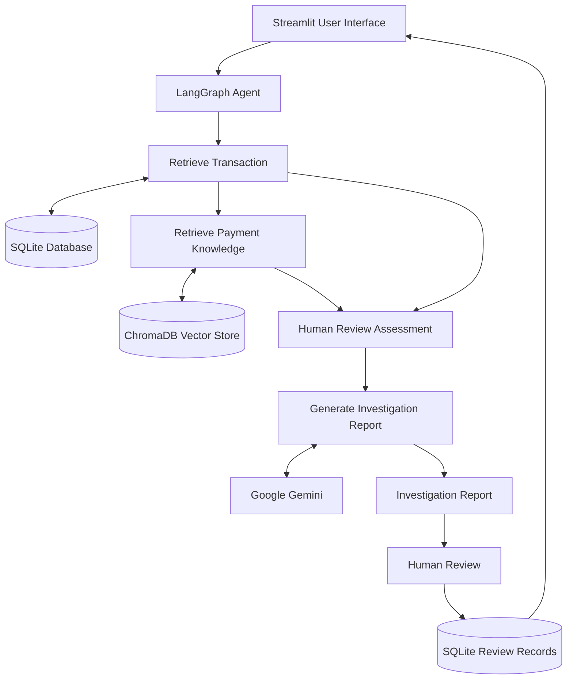

# Payment Failure Investigation Agent

An AI-powered payment investigation prototype that analyses failed and pending transactions, retrieves relevant troubleshooting guidance, and generates investigation reports with human-in-the-loop review.

## Overview

Payment failures can occur for several reasons, including bank declines, UPI timeouts, and payment gateway issues. Investigating these failures often requires checking transaction details, understanding failure codes, and referring to troubleshooting documentation.

This project demonstrates how an AI agent can assist with that investigation process.

The application retrieves transaction information from a SQLite database, uses Retrieval-Augmented Generation (RAG) to find relevant troubleshooting guidance, applies rule-based checks to identify cases requiring human review, and uses Google Gemini to generate an investigation report.

## Key Features

- **Transaction Investigation:** Retrieve and analyse transaction details using a transaction ID.
- **RAG-based Knowledge Retrieval:** Search relevant payment troubleshooting guidance using ChromaDB and sentence-transformer embeddings.
- **AI-generated Investigation Reports:** Use Google Gemini to generate contextual explanations and recommended next steps.
- **Human-in-the-Loop Review:** Identify transactions requiring manual verification or escalation.
- **Review Management:** Save reviewer decisions and notes in SQLite.
- **Review History:** View previously submitted human review records through the application.
- **Automated Testing:** Validate investigation logic, review assessment, and knowledge retrieval using pytest.

## Architecture



## Design Highlights

- **Agentic Workflow:** Uses LangGraph to organize transaction retrieval, knowledge retrieval, review assessment, and investigation.
- **Grounded Responses:** Uses RAG to provide troubleshooting context rather than relying only on the LLM's general knowledge.
- **Deterministic Review Assessment:** Applies explicit business rules to identify transactions requiring human intervention.
- **Human Oversight:** Keeps investigation recommendations separate from actual payment operations and records reviewer decisions.
- **Testability:** Uses mocked LLM responses to test agent behaviour without depending on external API availability.

## Investigation Workflow

1. The user enters a transaction ID through the Streamlit interface.
2. The LangGraph agent retrieves the corresponding transaction from SQLite.
3. The RAG component searches the troubleshooting knowledge base for relevant failure information.
4. A rule-based assessment determines whether the transaction requires human review.
5. Google Gemini generates an investigation report using the transaction details and retrieved knowledge.
6. The application displays the findings and recommended next steps.
7. A reviewer can record a decision and notes, which are persisted in SQLite.

## Technology Stack

| Component            | Technology                               |
| -------------------- | ---------------------------------------- |
| Programming Language | Python                                   |
| User Interface       | Streamlit                                |
| Agent Orchestration  | LangGraph                                |
| LLM                  | Google Gemini                            |
| LLM Integration      | LangChain                                |
| Embeddings           | Sentence Transformers (all-MiniLM-L6-v2) |
| Vector Database      | ChromaDB                                 |
| Relational Database  | SQLite                                   |
| Testing              | Pytest                                   |

## Project Structure

```text
payment-failure-investigation-agent/
├── app.py
├── data/
│   ├── payments.db
│   └── chroma_db/
├── knowledge_base/
│   └── payment_troubleshooting.md
├── scripts/
│   ├── check_db.py
│   └── test_gemini.py
├── src/
│   ├── __init__.py
│   ├── agent.py
│   ├── database.py
│   ├── llm.py
│   └── retriever.py
├── tests/
│   └── test_agent.py
├── .env.example
├── .gitignore
├── pytest.ini
├── requirements.txt
└── README.md
```

**Note:** The database and vector store are generated locally when the application is initialized and are not committed to the repository.

## Getting Started

### Prerequisites

- Python 3.12 or later
- Google Gemini API key

### 1. Clone the repository

```bash
git clone https://github.com/Niraimadi/payment-failure-investigation-agent.git
cd payment-failure-investigation-agent
```

Data format:                                                RDF-Turtle                  JSON-LD                  JSON                  CSV                  RDF/XML                  Markdown                  RSS                  Atom            &#x20;

### 2. Create and activate a virtual environment

**Windows:**

```bash
python -m venv .venv
.venv\Scripts\activate
```

Data format:                                                RDF-Turtle                  JSON-LD                  JSON                  CSV                  RDF/XML                  Markdown                  RSS                  Atom            &#x20;

### 3. Install dependencies

```bash
pip install -r requirements.txt
```

Data format:                                                RDF-Turtle                  JSON-LD                  JSON                  CSV                  RDF/XML                  Markdown                  RSS                  Atom            &#x20;

### 4. Configure environment variables

Create a `.env` file in the project root using `.env.example` as a template.

```env
GOOGLE_API_KEY=your_google_api_key
GEMINI_MODEL=gemini-3.1-flash-lite
```

Data format:                                                RDF-Turtle                  JSON-LD                  JSON                  CSV                  RDF/XML                  Markdown                  RSS                  Atom            &#x20;

Replace the placeholder with your Gemini API key.

### 5. Initialize the database

```bash
python -m src.database
```

Data format:                                                RDF-Turtle                  JSON-LD                  JSON                  CSV                  RDF/XML                  Markdown                  RSS                  Atom            &#x20;

This initializes the local SQLite database and the required tables.

### 6. Run the application

```bash
streamlit run app.py
```

Data format:                                                RDF-Turtle                  JSON-LD                  JSON                  CSV                  RDF/XML                  Markdown                  RSS                  Atom            &#x20;

The application will open in your browser.

## Development Scripts

The `scripts/` directory contains standalone scripts for development and verification.

**Test Gemini API connectivity:**

```bash
python scripts/test_gemini.py
```

Data format:                                                RDF-Turtle                  JSON-LD                  JSON                  CSV                  RDF/XML                  Markdown                  RSS                  Atom            &#x20;

**Check database tables:**

```bash
python scripts/check_db.py
```

Data format:                                                RDF-Turtle                  JSON-LD                  JSON                  CSV                  RDF/XML                  Markdown                  RSS                  Atom            &#x20;

## Running Tests

Run the automated test suite from the project root:

```bash
python -m pytest -v
```

Data format:                                                RDF-Turtle                  JSON-LD                  JSON                  CSV                  RDF/XML                  Markdown                  RSS                  Atom            &#x20;

The current test suite contains 8 test cases covering:

- Human-review assessment for different transaction scenarios.
- Handling unknown transaction IDs.
- Retrieval of matching troubleshooting knowledge.
- Skipping knowledge retrieval for successful transactions.

The LLM is mocked during agent tests to keep them independent of external API availability.

## Sample Transactions

The project uses synthetic transaction records for demonstration.

| Transaction ID | Payment Method | Status  | Failure Code       |
| -------------- | -------------- | ------- | ------------------ |
| TXN-10025      | UPI            | FAILED  | UPI_TIMEOUT        |
| TXN-10026      | CARD           | FAILED  | INSUFFICIENT_FUNDS |
| TXN-10027      | UPI            | SUCCESS | —                  |
| TXN-10028      | CARD           | PENDING | GATEWAY_TIMEOUT    |
| TXN-10029      | NET_BANKING    | FAILED  | BANK_DECLINED      |

## Scope and Limitations

- This is an independently developed prototype using synthetic transaction data.
- It does not connect to live payment gateways or process actual payments.
- The troubleshooting knowledge base contains demonstration guidance, not official payment-provider documentation.
- Human-review decisions are recorded locally and do not trigger actual payment operations, refunds, or retries.
- AI-generated findings are intended to support investigation and should be verified by a human reviewer.

## Future Enhancements

- Integrate additional payment failure scenarios and troubleshooting knowledge.
- Introduce more advanced agent workflows for investigation and escalation.
- Add structured investigation outputs and improved evaluation datasets.
- Explore integration with payment-provider APIs in a controlled test environment.

---

**Built as a hands-on project exploring Agentic AI, RAG, LangGraph, and human-in-the-loop workflows in a fintech use case.**